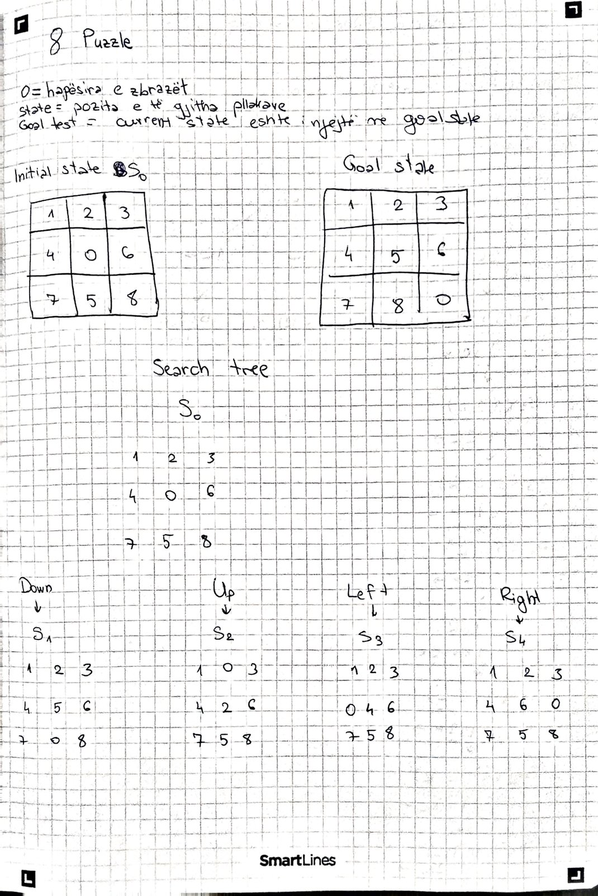
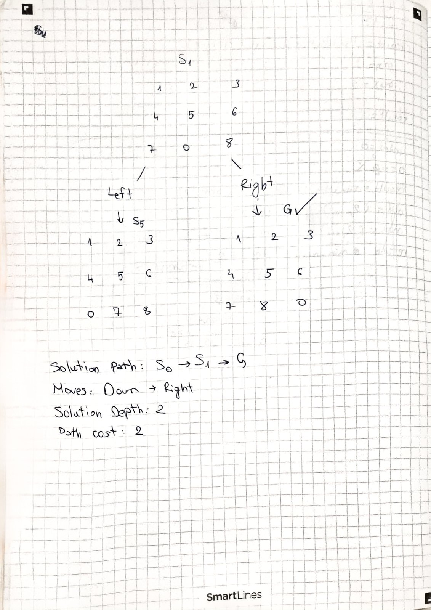
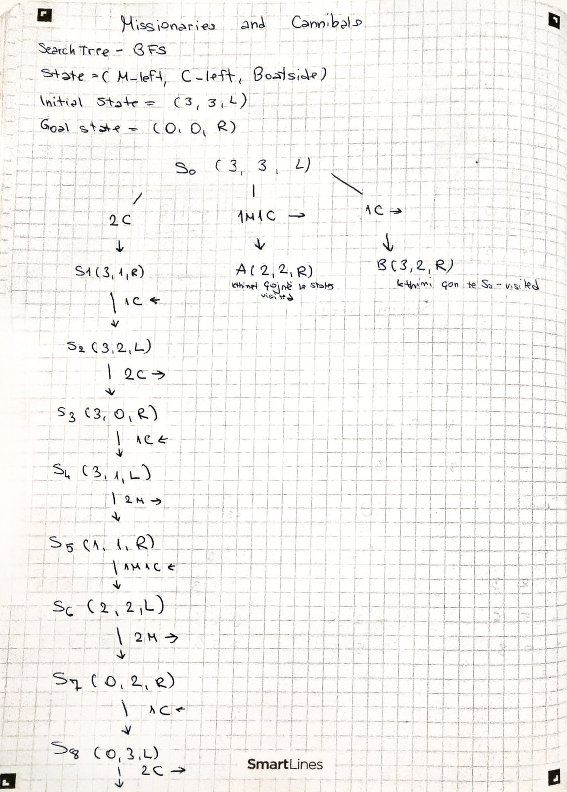
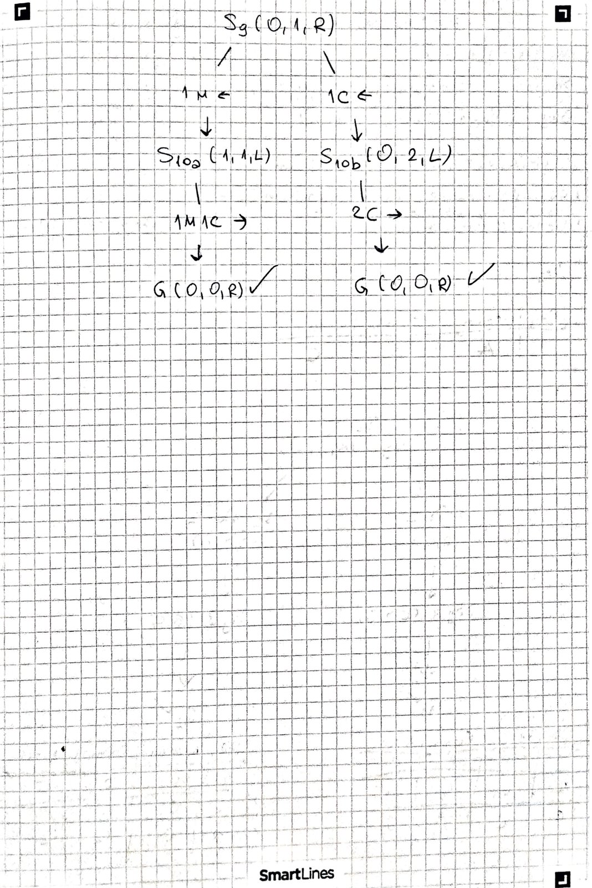
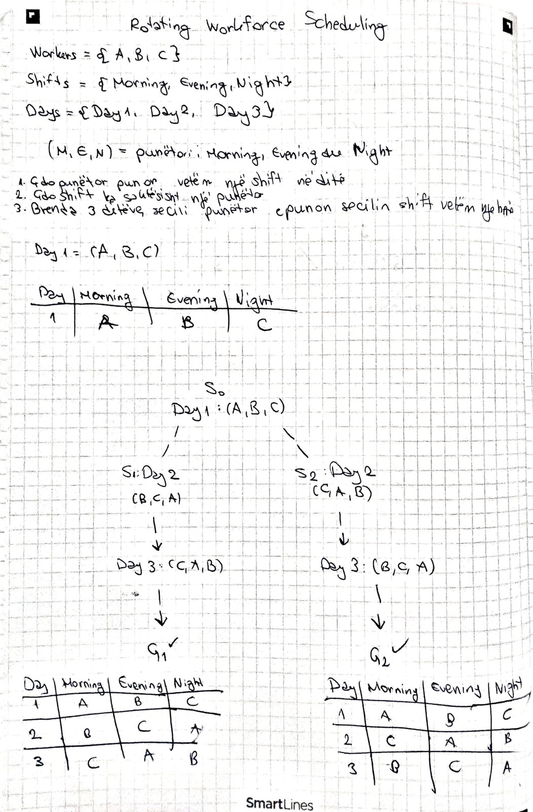
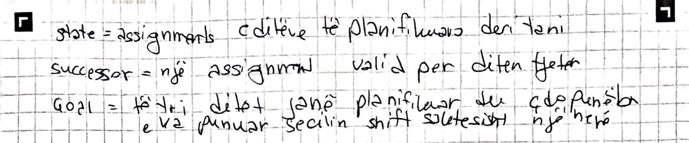

# Search Trees

Search Trees për 8-Puzzle, Missionaries and Cannibals dhe Rotating Workforce
Scheduling, të vizatuara në letër. Meqë detyra nuk jep initial states
konkrete, për secilin problem është zgjedhur një shembull i vogël.

Një state i përsëritur shënohet `visited` dhe nuk zgjerohet përsëri.

## 1. 8-Puzzle

- **State:** pozita e 8 pllakave dhe e boshllëkut (`0`).
- **Successors:** lëvizja e boshllëkut Down, Up, Left, Right. Lëvizja që
  kthehet menjëherë te parent-i nuk gjenerohet.
- **Initial:** `1 2 3 / 4 0 6 / 7 5 8`
- **Goal:** `1 2 3 / 4 5 6 / 7 8 0`
- **Solution:** `S0 --Down--> S1 --Right--> G`, depth 2, path cost 2.

## 2. Missionaries and Cannibals

- **Rregullat:** 3 missionaries dhe 3 cannibals në bregun e majtë; barka
  mban 1 ose 2 persona; në asnjë breg cannibals nuk mund të jenë më shumë se
  missionaries (përveç kur aty nuk ka missionaries).
- **State:** `(M_left, C_left, BoatSide)`
- **Initial:** `(3,3,L)` **Goal:** `(0,0,R)`
- **Moves:** `2M`, `2C`, `1M1C`, `1M`, `1C`.
- **Pema:** BFS; states invalidë nuk vizatohen, states të përsëritur
  shënohen `visited`. Nga S9 dalin dy rrugë me të njëjtën gjatësi deri te G.
- **Solution:** 11 kalime:
  `2C→, 1C←, 2C→, 1C←, 2M→, 1M1C←, 2M→, 1C←, 2C→, 1M←, 1M1C→`.

## 3. Rotating Workforce Scheduling

- **Shembulli:** 3 punëtorë `A, B, C`; 3 shifts Morning, Evening, Night;
  3 ditë.
- **Constraints:** çdo punëtor punon një shift në ditë; çdo shift ka
  saktësisht një punëtor; brenda 3 ditëve çdo punëtor e punon secilin shift
  një herë.
- **State:** assignments e ditëve të planifikuara; tuple `(M, E, N)` tregon
  punëtorin e secilit shift.
- **Initial:** Day 1 = `(A,B,C)` (symmetry breaking).
- **Pema:** Day 2 ka vetëm dy mundësi valide, `(B,C,A)` dhe `(C,A,B)`; Day 3
  është i detyruar. Dy goals: `G1` dhe `G2`.

**Lidhja me modelin real (Musliu).** Në RWS real, të gjithë punonjësit
ndjekin të njëjtin orar ciklik, secili me një offset; ka demand për çdo
shift/ditë, days off, gjatësi min/max të blloqeve dhe forbidden sequences.
Te `G1` kjo shihet: A punon `M N E`, B `E M N`, C `N E M`, pra të tre ndjekin
pattern-in `(M, N, E)` me offset një ditë. Me forbidden sequence `N → M`
(Night pastaj Morning), dega `S2` pritet që në Day 2, sepse C kalon nga
Night në Morning, dhe mbetet vetëm `G1`.
