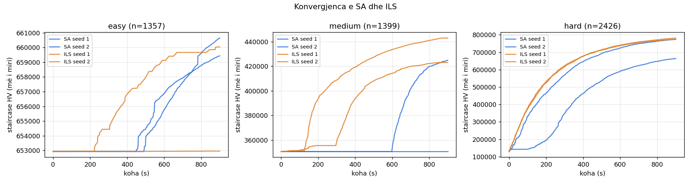
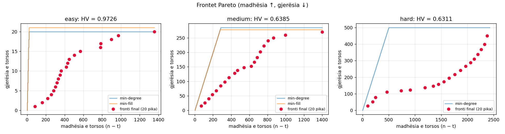

# Problemi 4 – Torso Decompositions (ESA SpOC-3) me Metaheuristika

**Kërkesa e detyrës:** të zgjidhet problemi
[Torso Decompositions](https://optimise.esa.int/challenge/spoc-3-torso-decompositions/About) duke përdorur
algoritme metaheuristike. Sipas rekomandimit të profesorit, ekzekutimi bëhet në **Kaggle** (CPU falas):
[kaggle.com/code/tringab/torso-decompositions-spoc3](https://www.kaggle.com/code/tringab/torso-decompositions-spoc3).

## 1. Problemi (sipas README-s zyrtare)

Burimi: [github.com/esa/SpOC3 – Challenge 1](https://github.com/esa/SpOC3/tree/main/Challenge%201%20Torso%20Decompositions).
Faqja e platformës ngarkohet me JavaScript, prandaj u përdor README-ja zyrtare në GitHub, ku janë
përkufizimet dhe instancat.

* **Hyrja:** graf i padrejtuar dhe i lidhur G me nyje 0..n−1 (listë brinjësh).
* **Vektori i vendimit:** `x = [p₁, …, pₙ, t]`, ku p është permutacion i nyjeve dhe t ∈ {0, …, n−1}.
* **Orientimi:** brinja {u, v} orientohet (u, v) nëse u del para v në permutacion.
* **Brinjët e reja:** skanohet permutacioni nga e majta në të djathtë. Kur nyja u ka dy brinjë dalëse
  drejt v dhe w që nuk janë fqinjë, shtohet brinja {v, w}.
* **Torso:** n − t nyjet e fundit. **Madhësia** = n − t. **Gjerësia** = outdegree maksimal i një nyjeje të
  torsos, duke numëruar edhe brinjët e reja.
* **Objektivat:** madhësia e torsos **maksimale** (t minimal) dhe gjerësia **minimale**. Problemi është
  shumë-objektiv: dorëzohen **≤ 20 vektorë** dhe cilësia matet me **hypervolume**. Gjerësia mbi 500
  vlerësohet si 501.

| Instanca | ID e problemit | Nyje | Brinjë |
|---|---|---|---|
| easy | `small-graph` | 1 357 | 2 280 |
| medium | `medium-graph` | 1 399 | 13 799 |
| hard | `large-graph` | 2 426 | 253 895 |

## 2. Funksioni i vlerësimit dhe validimi

Kodi zyrtar i vlerësimit (UDP i pygmo-s) **nuk është publik**: nuk ndodhet as në GitHub, as në serverin
e të dhënave. Prandaj u implementua sipas përkufizimit zyrtar (`torso.py`) dhe u validua:

1. **Shembulli zyrtar:** për grafin me 10 nyje dhe `x = [0,1,2,4,5,3,6,8,9,7,6]` jep **madhësi 4, gjerësi 2**,
   saktësisht si README-ja.
2. **Procedura fjalë për fjalë:** në 200 grafe të rastësishme, outdegree-t përputhen me një simulim të
   drejtpërdrejtë të procedurës zyrtare (`test_torso.py`).

**Efikasiteti.** Procedura e shtimit të brinjëve është "loja e eliminimit". Kur përpunohet nyja në
pozicionin i, fqinjët e saj të mëvonshëm bëhen klikë. Mjafton t'ia kalojmë bashkësinë e tyre fqinjit
më të hershëm, sepse klika përhapet kur të përpunohet ai (Rose, Tarjan & Lueker, 1976). Bashkësitë
ruhen si **bitset-e** (Python int), prandaj një vlerësim kushton O(n) operacione: rreth 2–4 ms edhe për
grafin hard. Lëvizjet swap/insert i përditësojnë bitset-et në mënyrë **inkrementale**.

**Një permutacion jep një front të tërë.** Për çdo prag t, gjerësia është `w(t) = max_{i ≥ t} outdeg(i)`
(maksimumi i sufiksit). Kështu çdo permutacion jep menjëherë pikat (t, w(t)) për të gjitha t.

**Hypervolume.** Minimizojmë (t, gjerësia) me pikë reference **(n, 501)**. README-ja zyrtare nuk e
specifikon pikën e referencës. Zgjedhja jonë bazohet në rregullin që gjerësia mbi 500 = 501 dhe në
t ≤ n − 1. Raportojmë edhe HV-në e normalizuar, HV / (n · 501).

## 3. Algoritmet

### 3.1 Zgjidhjet fillestare (konstruktive)
* **Min-degree:** eliminohet gjithmonë nyja me shkallën më të vogël në grafin aktual (me brinjët e shtuara).
* **Min-fill:** eliminohet nyja që shton më pak brinjë të reja. Përdoret vetëm për easy dhe medium, sepse
  për hard është shumë e shtrenjtë.

Këto janë heuristikat klasike për renditjen e eliminimit (treewidth). Gjerësia e permutacionit të plotë
(t = 0) është pikërisht gjerësia e eliminimit.

### 3.2 Funksioni objektiv për metaheuristikat
Maksimizohet hypervolume-i i frontit të plotë që jep permutacioni:

$$HV(\pi) = \sum_{t=0}^{n-1} \big(501 - w_\pi(t)\big)$$

Kështu problemi shumë-objektiv kthehet në një objektiv të vetëm, pa humbur informatë për asnjë prag t.
Të gjitha pikat jo-dominuese që gjenden gjatë kërkimit ruhen në një **arkiv**.

### 3.3 Lëvizjet (fqinjësia)
* **swap(i, j)**: ndërron dy nyje;
* **insert(i, j)**: e zhvendos një nyje nga pozicioni i në j.

Arsyetimi për zgjedhjen e pozicioneve:
* 50%: j zgjidhet **afër** i-së (|i − j| ≤ 30). Ndryshimet e vogla në renditjen e eliminimit e ruajnë
  strukturën e mirë që gjeti heuristika konstruktive.
* 30%: i është një **nyje kritike**, d.m.th. ajo që e përcakton gjerësinë për një prag (deg(i) = w(i)).
  Kështu sulmohet drejtpërdrejt "bottleneck"-u.
* 20%: dy pozicione krejt të rastit, për diversifikim.

Në provat e para, lëvizjet krejt të rastit pothuajse gjithmonë e përkeqësonin zgjidhjen min-degree, dhe
kjo e motivoi fqinjësinë lokale.

### 3.4 Simulated Annealing (SA)
* Përkeqësimi Δ < 0 pranohet me probabilitet exp(Δ/T).
* **T₀ kalibrohet automatikisht** si mesatarja e |Δ| e 100 lëvizjeve përkeqësuese. Kështu në fillim një
  përkeqësim tipik pranohet me probabilitet ≈ e⁻¹.
* T ulet **gjeometrikisht** sipas kohës, nga T₀ deri në 0.01.

### 3.5 Iterated Local Search (ILS)
* **Kërkim lokal:** hill climbing me first improvement mbi lëvizje të rastit, duke lejuar lëvizje anësore
  (plateau), deri në 200 dështime radhazi.
* **Perturbim:** 8 lëvizje të rastit.
* **Pranimi:** vazhdohet nga zgjidhja e re nëse nuk është më e keqe se më e mira; përndryshe kthehet te
  më e mira.

### 3.6 Fronti final
Bashkohen arkivat e të gjitha ekzekutimeve dhe frontet konstruktive. Me **programim dinamik** zgjidhen
≤ 20 pikat që **maksimizojnë hypervolume-in**; në 2D kjo zgjedhje është optimale dhe testohet kundrejt
forcës brutale. Çdo vektor i zgjedhur **rivlerësohet** me `torso.evaluate` para se të shkruhet në skedarin
e dorëzimit.

## 4. Rezultatet

Ekzekutuar në **Kaggle** (4 CPU, Python 3.13): **900 s për ekzekutim**, **2 seed** për çdo algoritëm,
12 ekzekutime paralelisht, 46 min gjithsej. Testet kaluan edhe në Kaggle. Tabelat e plota janë te
[results/results.md](results/results.md) dhe të dhënat e papërpunuara te `results/summary.json`.

**Fronti final** (≤ 20 pika, HV i normalizuar = HV / (n · 501)):

| Instanca | Konstruktive më e mirë | **SA + ILS (fronti final)** | Përmirësimi |
|---|---|---|---|
| easy | 0.9605 (min-degree) | **0.9726** | +1.3% |
| medium | 0.4979 (min-fill) | **0.6385** | +28% |
| hard | 0.1091 (min-degree) | **0.6311** | ×5.8 |

**Për çdo ekzekutim** (staircase HV = funksioni objektiv; HV20 = HV i 20 pikave më të mira të atij ekzekutimi):

| Instanca | Algoritmi | Seed 1: staircase HV / HV20 | Seed 2: staircase HV / HV20 | Vlerësime / ekzekutim |
|---|---|---|---|---|
| easy | SA | 660 648 / 660 982 | 659 432 / 659 435 | ≈ 244 000 |
| easy | ILS | 660 040 / 660 404 | 652 954 / 654 938 | ≈ 241 000 |
| medium | SA | 350 758 / 407 275 | 424 996 / 440 713 | ≈ 216 000 |
| medium | ILS | 423 083 / 423 413 | **442 927** / 439 055 | ≈ 218 000 |
| hard | SA | 773 624 / 755 989 | 663 501 / 648 590 | ≈ 97 000 |
| hard | ILS | **781 455** / 763 201 | 774 736 / 758 439 | ≈ 97 000 |

Pikat e frontit final, si (madhësia e torsos, gjerësia):
* **easy:** (1357, 20), (972, 19), (898, 18), (784, 17), (782, 16), (567, 15), … , (160, 2), (84, 1)
* **medium:** (1399, 270), (995, 260), (866, 250), … , (111, 26), (70, 15)
* **hard:** (2377, 450), (2326, 399), (2262, 367), … , (193, 51), (99, 27)





**Analiza:**
* **Metaheuristikat e përmirësojnë shumë frontin konstruktiv**, sidomos në grafet e dendura. Te hard,
  min-degree jep gjerësi ≈ 500 për çdo torso me mbi 500 nyje. Pas kërkimit, një torso me 1 554 nyje ka
  gjerësi 173, dhe ajo me 2 377 nyje ka gjerësi 450. HV-ja rritet 5.8 herë.
* **Te easy** fitimi është i vogël (+1.3%), sepse min-degree është tashmë shumë i mirë: gjerësia e plotë
  është 20, kurse HV maksimal teorik është 1.0. Megjithatë fronti fiton pika të reja për torso të mesme
  (p.sh. madhësi 567 me gjerësi 15 në vend të 20).
* **ILS është më i qëndrueshëm se SA.** Te hard dy seed-et e ILS japin 781 455 dhe 774 736, kurse SA jep
  773 624 dhe 663 501. Te medium SA me seed 1 nuk e përmirësoi objektivin brenda 900 s: kurba është e
  sheshtë. Megjithatë arkivi i tij gjeti pika të dobishme (HV20 = 407 275 > 348 951).
* **Kurbat e konvergjencës** kanë rrafshina të gjata e pastaj ngjitje të shpejta. Shumica e lëvizjeve
  nuk e ndryshojnë gjerësinë maksimale (peizazh me plateau). Pasi zhvendoset nyja "bottleneck", gjerësia
  bie për shumë prage njëherësh. Kjo e arsyeton zgjedhjen e lëvizjeve mbi **nyjet kritike** dhe
  pranimin e lëvizjeve anësore te ILS.
* Te easy dhe hard kurbat ende rriten në fund të 900 s, prandaj me më shumë kohë fronti do të
  përmirësohej edhe më.
* **Bashkimi i ekzekutimeve ndihmon:** fronti final (HV 767 112 te hard) është më i mirë se çdo
  ekzekutim i veçantë (max 763 201), sepse ekzekutimet e ndryshme gjejnë pika të mira në rajone të
  ndryshme të frontit.

**Skedarët e dorëzimit** (`submissions/*.json`) janë në formatin zyrtar të ESA-s: 20 vektorë për
instancë, secili me n + 1 numra të plotë, me `problem` = `small-graph` / `medium-graph` / `large-graph`.
Pas shkarkimit nga Kaggle u **rivlerësuan lokalisht** dhe japin saktësisht të njëjtin HV.

## 5. Ekzekutimi

**Në Kaggle** (versioni i raportuar):
* notebook-u `kaggle/torso_decompositions.ipynb` ndërtohet me `python make_notebook.py --seconds 900 --seeds 2`;
* dërgohet me `kaggle kernels push -p kaggle`;
* rezultatet merren me `kaggle kernels output tringab/torso-decompositions-spoc3`.

**Lokalisht:**

```bash
pip install -r ../requirements.txt
python -m unittest test_torso -v              # validimi i vlerësimit
python run.py --seconds 30                    # provë e shkurtër (të gjitha instancat, paralel)
python run.py --seconds 900 --seeds 2         # si në Kaggle
```

## 6. Skedarët

| Skedari | Përmbajtja |
|---|---|
| `torso.py` | leximi i grafit, vlerësimi, fronti, hypervolume, zgjedhja e 20 pikave (DP) |
| `search.py` | vlerësuesi inkremental, min-degree, min-fill, SA, ILS |
| `run.py` | ekzekutimi paralel, bashkimi i fronteve, dorëzimet, tabela dhe grafikët |
| `make_notebook.py` | ndërton notebook-un e Kaggle nga këta skedarë |
| `kaggle/` | notebook-u dhe metadata e Kaggle |
| `test_torso.py` | testet e vlerësimit (shembulli zyrtar, procedura fjalë për fjalë, hypervolume) |
| `data/` | instancat zyrtare (easy, medium, hard) |
| `results/` | tabela, grafikët dhe `summary.json` nga Kaggle |
| `submissions/` | skedarët JSON në formatin zyrtar të dorëzimit (≤ 20 vektorë për instancë) |
