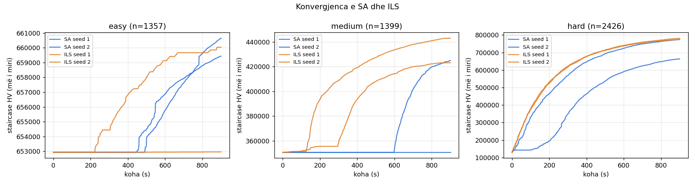
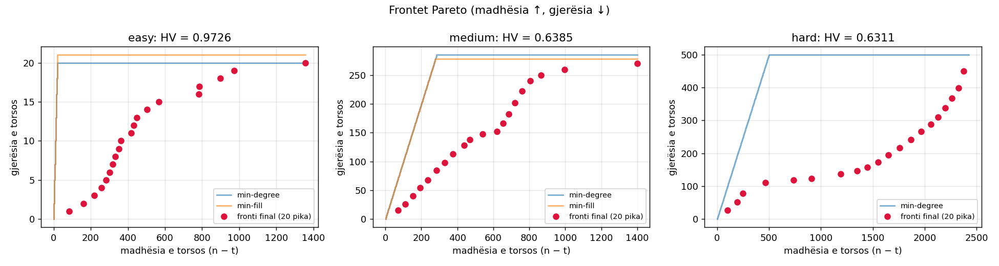

# Rezultatet – Torso Decompositions (ESA SpOC-3)

900 s për ekzekutim, 2 seed për algoritëm. Hypervolume: minimizim i (t, gjerësia), pika e referencës (n, 501). *Staircase HV* = HV i frontit të plotë të një permutacioni (funksioni objektiv); *HV20* = HV i 20 pikave më të mira (sa lejon dorëzimi).

## Instancat dhe zgjidhjet konstruktive

| instanca | n | m | metoda | koha (s) | gjerësia (t=0) | staircase HV | HV20 |
|---|---|---|---|---|---|---|---|
| easy | 1357 | 2280 | min-degree | 0.14 | 20 | 652927 | 652926 |
| easy | 1357 | 2280 | min-fill | 0.41 | 21 | 651591 | 651589 |
| medium | 1399 | 13799 | min-degree | 0.24 | 285 | 342939 | 341035 |
| medium | 1399 | 13799 | min-fill | 26.07 | 278 | 350758 | 348951 |
| hard | 2426 | 253895 | min-degree | 0.82 | 499 | 129602 | 123602 |

## Metaheuristikat

| instanca | algoritmi | seed | vlerësime | staircase HV fillim → fund | HV20 | pika jo-dominuese |
|---|---|---|---|---|---|---|
| easy | SA | 1 | 243776 | 652927 → 660648 | 660982 | 21 |
| easy | SA | 2 | 244326 | 652927 → 659432 | 659435 | 21 |
| easy | ILS | 1 | 241775 | 652927 → 660040 | 660404 | 21 |
| easy | ILS | 2 | 240165 | 652927 → 652954 | 654938 | 21 |
| medium | SA | 1 | 214796 | 350758 → 350758 | 407275 | 279 |
| medium | SA | 2 | 216622 | 350758 → 424996 | 440713 | 279 |
| medium | ILS | 1 | 219176 | 350758 → 423083 | 423413 | 279 |
| medium | ILS | 2 | 218006 | 350758 → 442927 | 439055 | 271 |
| hard | SA | 1 | 97675 | 129602 → 773624 | 755989 | 500 |
| hard | SA | 2 | 97298 | 129602 → 663501 | 648590 | 500 |
| hard | ILS | 1 | 97056 | 129602 → 781455 | 763201 | 500 |
| hard | ILS | 2 | 96731 | 129602 → 774736 | 758439 | 500 |

## Fronti final (bashkimi i të gjitha ekzekutimeve, 20 pikat me HV maksimal)

| instanca | HV | HV i normalizuar | pikat (madhësia, gjerësia) |
|---|---|---|---|
| easy | 661195 | 0.9726 | (1357, 20), (972, 19), (898, 18), (784, 17), (782, 16), (567, 15), (504, 14), (448, 13), (432, 12), (419, 11), (364, 10), (352, 9), (332, 8), (318, 7), (302, 6), (283, 5), (257, 4), (220, 3), (160, 2), (84, 1) |
| medium | 447523 | 0.6385 | (1399, 270), (995, 260), (866, 250), (806, 240), (761, 222), (719, 202), (687, 182), (655, 166), (620, 152), (541, 148), (469, 138), (439, 128), (374, 113), (329, 98), (284, 85), (237, 68), (194, 54), (154, 40), (111, 26), (70, 15) |
| hard | 767112 | 0.6311 | (2377, 450), (2326, 399), (2262, 367), (2198, 338), (2127, 310), (2059, 288), (1968, 266), (1867, 241), (1758, 216), (1651, 195), (1554, 173), (1446, 157), (1349, 147), (1189, 137), (908, 124), (736, 119), (466, 111), (248, 78), (193, 51), (99, 27) |

